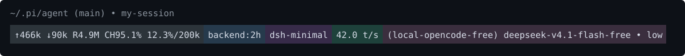

# pi-colored-footer

A [Pi](https://pi.dev) extension that **replaces** Pi's default footer with a
version that draws every status as a full-width, background-colored block — all
on one row. It uses only Pi's public `ctx.ui.setFooter()` API and the packages
Pi's extension loader already supplies, so nothing in Pi's installed source,
bundle, or launcher is patched.

## What Pi's default footer looks like

Out of the box, Pi's footer is three dim rows:

1. The working directory (relative to `~`), the git branch, and the session name.
2. Usage totals (`↑` input, `↓` output, `R` cache read, `W` cache write,
   `CH<rate>%`, `$cost`), the context percentage / window, and the selected model
   (shown with its provider when more than one provider is available).
3. Extension statuses registered with `ctx.ui.setStatus(...)`.

## What this extension changes

It replaces that footer. The data is the same; the layout is not:

- **Row 1** is Pi's dim path / branch / session line, unchanged.
- **Row 2** renders the usage totals + context, the selected model, and every
  plugin status as adjacent, background-colored blocks, left to right:
  - the usage totals and the context share a single `stats` block, kept together
    exactly like Pi's own row;
  - the model is its own `model` block;
  - each plugin status is its own block.
- Any status that does **not** belong to a configured block is still shown,
  unchanged, on a plain row below.

Each block is weighted by the longest text it has shown during the current Pi
process, so the row stays stable as values change. The foreground colors a plugin
sets are preserved, including the warning / error tint Pi applies to the context
once it climbs past 70% / 90%.

While drawing, the room left for each slot's text is broadcast on the shared
`pi.events` bus as `pi.footer.slotWidth` (`{ key, width }`). An extension that
owns a slot can subscribe and trim its status to fit the space it gets — for
example `pi-backend-start` narrows `🟢 uptime:2h` to `🟢 2h` and then to the dot
alone as the `backend` block shrinks.

## Example

With a few footer plugins installed, their statuses become colored blocks next to
the built-in `stats` and `model` blocks.

GitHub strips inline `style` / `class` / `id` from Markdown, so a background
color cannot be set with HTML in a README. The only thing that paints a real
background on GitHub is a rendered image, so the row below is a committed SVG
([`docs/footer-example.svg`](docs/footer-example.svg)) that draws the exact
blocks, colors, and text of the live footer — no external service, so it always
renders. It is one line, blocks adjacent, exactly like the live footer.



Same row as plain text (copy-paste / terminal):

```
~/.pi/agent (main) • my-session
⬛ ↑466k ↓90k R4.9M CH95.1% 12.3%/200k  🟦 backend:2h  🟪 dsh-minimal  🟩 42.0 t/s  🟫 (local-opencode-free) deepseek-v4.1-flash-free • low
```

The emoji square only stands in for the color; the real footer paints the whole
block (a `48;2;R;G;B` ANSI background), and the SVG above shows that full block.

| Swatch | Block | Background (RGB) | Hex | Contents |
| ------ | ----- | ---------------- | --- | -------- |
| `⬛` | `stats` | `44,52,58` | `#2C343A` | usage totals + context |
| `🟦` | `backend` | `38,58,76` | `#263A4C` | the `pi-backend-start` status |
| `🟪` | `dsh-minimal` | `55,43,73` | `#372B49` | the `pi-dsh-minimal` status |
| `🟩` | `tokenSpeed` | `30,65,59` | `#1E413B` | the `pi-token-speed` status |
| `🟫` | `model` | `58,46,62` | `#3A2E3E` | the selected model |

`backend`, `dsh-minimal`, and `tokenSpeed` are just the plugin slots that ship
preconfigured; they are examples, not a fixed set. Any plugin that calls
`setStatus` shows up as its own block, and the recipe for adding a slot is in
[Notes](#notes).

## Reordering the blocks

The blocks are drawn left to right in a configurable order. The built-in slots
`stats` (usage totals + context) and `model` come from the footer itself; the
plugin slots shipped by default are `backend`, `dsh-minimal`, and `tokenSpeed`.
The default order is `stats → backend → dsh-minimal → tokenSpeed → model`. The
order is stored in `~/.pi/agent/pi-colored-footer.json`
(`{"order": ["stats", ...]}`).

Run `/footer` to open an interactive reorder screen listing each block with its
color swatch and current text. Plugin blocks also show the owning extension
(`key · extension-name`); the built-in `stats` and `model` blocks are not labeled.
Since Pi's footer API only exposes status key → text, the owner is inferred by
scanning the installed extension sources for their `setStatus("<key>")` call. The
rows are ordered top-to-bottom exactly as the blocks appear left-to-right in the
footer, and the preview updates as you go:

- `↑` / `↓` move the selection (or the block you are holding).
- `space` grabs the selected block, and again drops it.
- `enter` saves the new order; `esc` (or `q`) cancels.
- `r` restores the default order.

For scripting, the same command still accepts arguments:

- `/footer` (no UI available, e.g. print mode) prints the current order.
- `/footer order <key...>` sets the full left-to-right order. Keys you omit are
  appended after the ones you list, in their previous order.
- `/footer up <key>` / `/footer down <key>` move one block one step.
- `/footer reset` restores the default order.

The command autocompletes its action names and slot keys, and changes take effect
immediately (no `/reload` needed).

## Install

```bash
pi install git:github.com/zrlu/pi-colored-footer
```

Or copy this directory into `~/.pi/agent/extensions/pi-colored-footer/`.

After installing or editing, run `/reload` or restart Pi. Normal managed Pi
upgrades replace the release directory and leave this user extension intact. If
a future release changes the public footer API, update this extension rather than
patching installed bundles.

## Disable

Move this directory outside `extensions` and run `/reload`.

## Notes

The color-block row is built in `layout.ts`. The slots and their background colors
are defined there (`FOOTER_SLOT_COLORS`). Adding a plugin slot there also makes it
reorderable through `/footer`; the extension fills that slot from the matching
plugin status. The built-in `stats` and `model` slots are listed in
`BUILTIN_SLOT_KEYS` and their text is computed in `index.ts` before the row is
rendered. The saved order is read and written by `config.ts`, and the interactive
reorder screen lives in `reorder.ts`.
